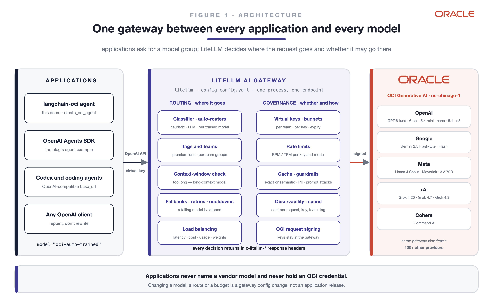
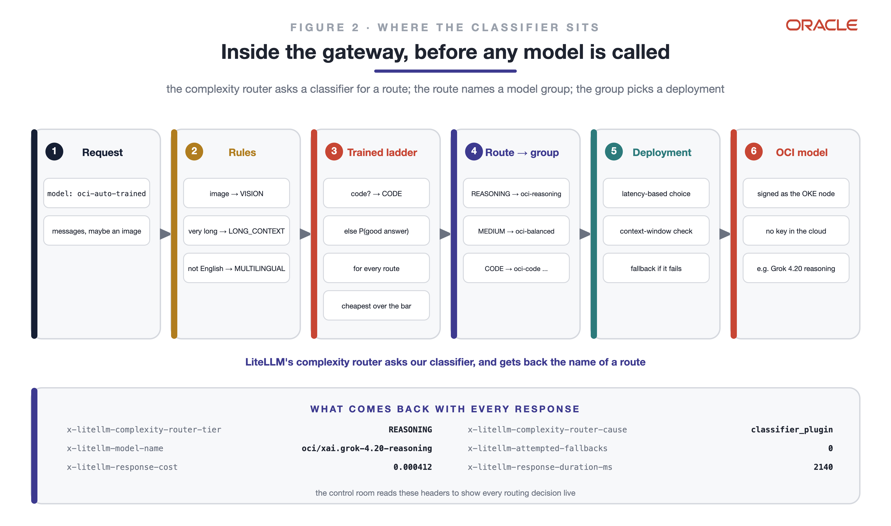
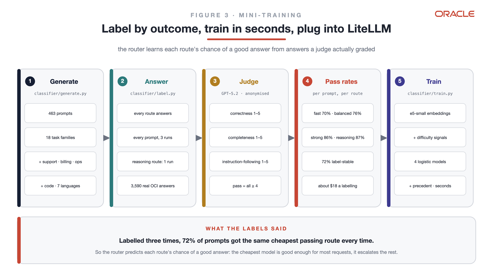
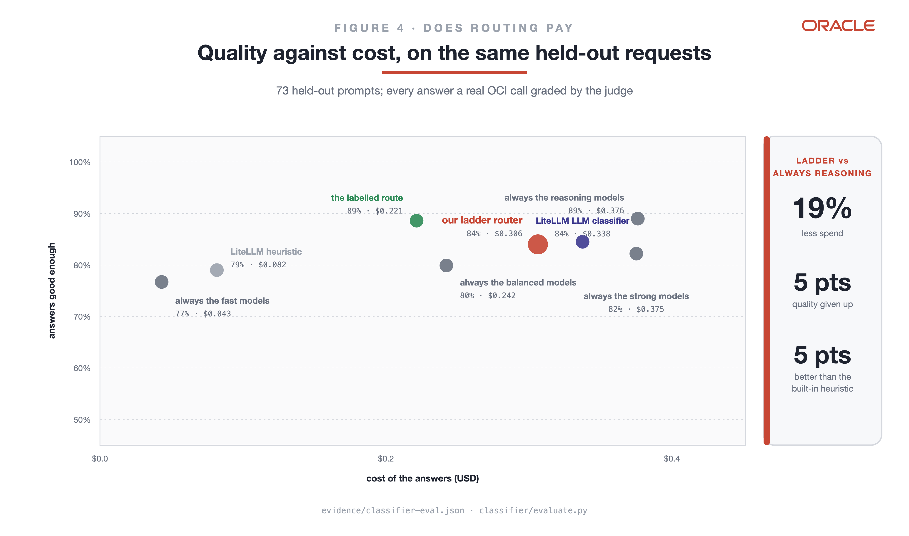
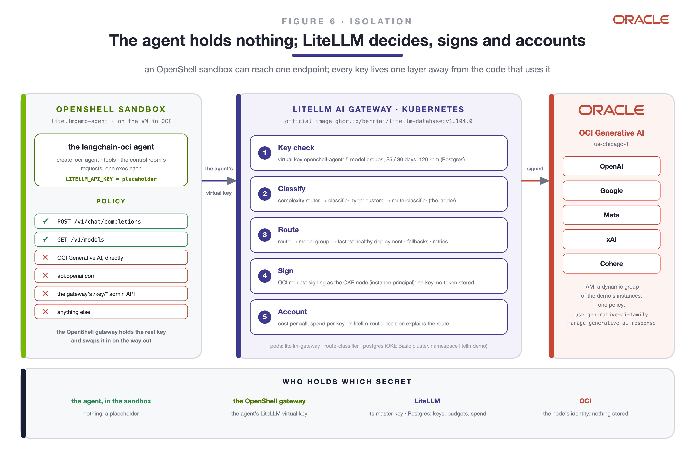
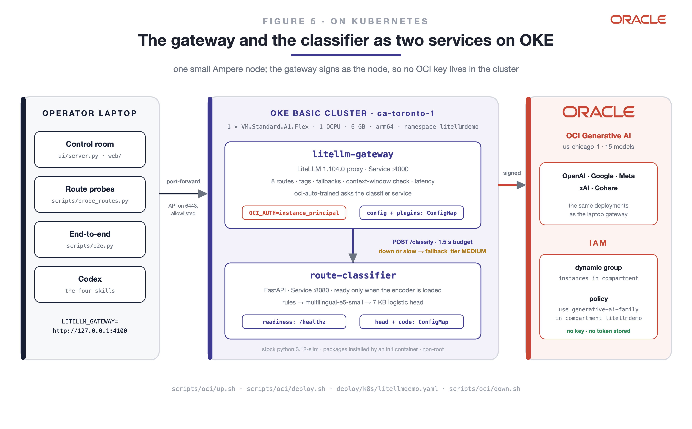

# The right model for every request: LiteLLM routing across OCI Generative AI

> **In short.** LiteLLM's AI Gateway puts twenty OCI Generative AI models behind one endpoint,
> and handles routing, keys, budgets and fallbacks in configuration alone. A classifier we
> trained on judged outcomes picks the model for each request, on CPU in milliseconds. It
> matches LiteLLM's LLM classifier for 9% less, and costs 19% less than always using reasoning
> models. An agent in an OpenShell sandbox holds no key, and a live control room shows every
> decision, tool call and result. Personal work; the company data is fictional.

An application sends every request to one OpenAI-compatible endpoint, the
[LiteLLM](https://github.com/BerriAI/litellm) AI Gateway, and asks for a
model group. The gateway decides which of **twenty OCI Generative AI
models** answers, across OpenAI, Google, Meta, xAI and Cohere: a
**classifier we mini-trained** reads the request and picks one of eight
routes, tags pick a customer lane, a context-window check and fallback chains
keep requests alive, and latency balances deployments. A
[langchain-oci](https://github.com/oracle/langchain-oracle) agent drives it
from inside an [NVIDIA OpenShell](https://github.com/NVIDIA/OpenShell)
sandbox that holds no key, a web control room shows every decision live with
LiteLLM's and OpenShell's own logs, and Codex builds and verifies it from a
spec and four skills.

Built on the integration announced in
[LiteLLM natively supports OCI Generative AI](https://blogs.oracle.com/ai-and-datascience/litellm-natively-supports-generative-ai).



## Routes, models and criteria

| Route | Model group | OCI models (backup) |
|---|---|---|
| SIMPLE: short facts, formatting | `oci-fast` | GPT-6-luna, GPT-5.4-nano (Gemini 2.5 Flash-Lite, Llama 4 Scout) |
| MEDIUM: explanations, summaries | `oci-balanced` | GPT-5.4-mini (Grok 4.20 non-reasoning, Gemini 2.5 Flash) |
| COMPLEX: multi-part analysis | `oci-strong` | GPT-6-sol (GPT-5.4) |
| REASONING: proofs, constrained planning | `oci-reasoning` | Grok 4.20 reasoning, Grok 4.7 (o3, o4-mini) |
| CODE | `oci-code` | GPT-5.3-codex, on OCI's Responses API (GPT-5.1, Grok 4.3) |
| VISION | `oci-vision` | GPT-6-luna, Gemini 2.5 Flash (Llama 4 Maverick) |
| LONG_CONTEXT | `oci-long` | Gemini 2.5 Flash (Llama 4 Maverick) |
| MULTILINGUAL | `oci-multilingual` | Cohere Command A (Gemini 2.5 Flash) |

Every model, its price and the price's source (OCI's public price list where
it has one): [evidence/model-portfolio.json](evidence/model-portfolio.json),
built by `scripts/portfolio.py` from the gateway config. The models were
chosen by a trial: every candidate answered the same 40 prompts, graded by one
judge ([evidence/model-trial.json](evidence/model-trial.json),
`classifier/model_trial.py`). Codex models are served by OCI only on its
Responses API, which LiteLLM's OCI provider does not speak;
`gateway/oci_responses.py` is a LiteLLM `CustomLLM` provider for it.

A route is decided by three layers, in order:

1. **Facts in the request**, by rules: an image → VISION; more than ~30k
   tokens → LONG_CONTEXT; not English → MULTILINGUAL.
2. **What the request needs**, by our trained ladder: a programming request →
   CODE; otherwise each route's chance of an answer the judge accepts, and the
   cheapest route that clears the quality bar.
3. **Business rules**, by the gateway: tags (`premium` → GPT-5.2), budgets
   and keys, latency, fallbacks, retries and cooldowns.

Three auto-routers classify the same request three ways, for comparison:
`oci-auto` (LiteLLM's built-in heuristic), `oci-auto-llm` (Gemini Flash-Lite
grades the request) and `oci-auto-trained` (ours, `classifier_type: custom`).



## The router: label by outcome, predict the chance of a good answer



1. **Generate**: the judge model writes 463 prompts across 18 task families,
   trivial to expert (general tasks plus support, billing, IT ops, finance and
   people ops), code tasks, and requests in seven languages.
2. **Label by outcome**: every route answers every prompt through the
   gateway; GPT-5.2 grades the anonymised answers on correctness,
   completeness and instruction-following (1-5); an answer passes at 4 or
   more on all three. Three runs per route (one for the reasoning route) give
   each prompt a pass rate per route: 3,590 judged answers, about $18 a labelling.
3. **Why not one label**: labelled three times, only 66% of prompts got the
   same cheapest passing route every time (63% with the first portfolio), so accuracy against one label tops
   out in the 60s and 70s for any model (bigger encoders, up to 568M weights,
   did not move it). The router predicts pass probabilities instead.
4. **Train the ladder** (`classifier/ladder.py`): per route, a logistic model on
   the multilingual-e5-small embedding and seven difficulty signals, trained on
   fractional outcomes, averaged with the pass rates of the 12 most similar
   labelled requests. A code head sends programming requests to CODE. Seconds
   on a laptop CPU; the shipped model is 210 KB.
5. **Choose the route set and the quality bar** inside the training split by
   5-fold cross-validation: the cheapest combination at least as good as always
   using the reasoning models. It chose the fast, strong and reasoning routes with a
   bar of 75%. Each request may set its own bar (`metadata.route_quality_bar`).
6. **Plug in**: `gateway/trained_classifier.py` implements LiteLLM's
   `ClassifierPlugin` (`async classify(context) -> route`).

## Results

Through the real gateway, on held-out prompts never seen in training or in
choosing the route set and the bar, every answer a real OCI call graded by the
same judge ([evidence/classifier-eval.json](evidence/classifier-eval.json)):

| Policy | Answers good enough | Cost of the answers | Code and language routes |
|---|---|---|---|
| always the fast models | 77% | $0.043 | — |
| always the balanced models | 80% | $0.242 | — |
| always the strong models | 82% | $0.375 | — |
| always the reasoning models | 89% | $0.376 | — |
| LiteLLM heuristic (`oci-auto`) | 79% | $0.082 | 0% |
| LiteLLM LLM classifier (`oci-auto-llm`) | 84% | $0.338 | 0% |
| **our ladder (`oci-auto-trained`, bar 75%)** | **84%** | **$0.306** | **100%** (see below) |
| the labelled route (perfect routing) | 89% | $0.221 | 100% |



With the newer models even the cheapest route gives a good answer 77% of the
time, and the strong and reasoning routes cost the same: routing pays most by
sending each request to the kind of model it needs. The ladder gives 5 points
more good answers than LiteLLM's heuristic, matches its LLM classifier at 9%
less, and stays 5 points under always using the reasoning models for 19% less.
Cross-validated over all 359 prompts it ties always-reasoning at about 25% less
([evidence/ladder-lab.json](evidence/ladder-lab.json)). Perfect routing gives
always-reasoning's quality at 41% less: the headroom is in the predictor, not
the models. The ladder can be wrong on a single request: on two demo prompts it
picks the strong route, which passed 1 and 0 times in 4 where reasoning passed
4 and 2 ([evidence/strong-vs-reasoning.json](evidence/strong-vs-reasoning.json)). The ladder is the only router that sends code
and other languages to their own models: 24 of 24 held-out code and language
prompts through the gateway, after the relabel for the current portfolio
(every label run a retired deployment answered was run again:
`classifier/label.py --redo`).
Held-out is 73 prompts: one prompt moves a score by 1.4 points; see
"Does it hold up?" below for fresh prompts and a second judge.

**Did we really train it?** Yes: supervised learning on judged outcomes. The
shipped router fits four logistic models (one per route) and a code head on
frozen multilingual-e5-small embeddings. In an earlier experiment on
single-run labels, fine-tuning the encoder itself (117.7M weights,
`classifier/finetune.py`, 47 s on the Mac's GPU) added about 8 points of label
accuracy ([evidence/finetune-comparison.json](evidence/finetune-comparison.json));
with more labelled traffic that is the next lever, on an OCI GPU.

## Does it hold up?

The held-out numbers come from the same prompt writer and the same judge as
the training labels. To test both, GPT-5.5 (a model the router never routes
to) wrote 150 new requests, every route answered each one, and two judges from
different vendors graded them: GPT-5.2, the training judge, and Gemini 2.5 Pro,
which is not in the portfolio. The judges agree on 89% of answers
([evidence/robustness.json](evidence/robustness.json)).

| Policy | Good answers, GPT-5.2 judge | Good answers, Gemini 2.5 Pro judge | Cost |
|---|---|---|---|
| always the fast models | 85% | 84% | $0.127 |
| always the balanced models | 83% | 89% | $0.439 |
| always the strong models | 91% | 99% | $0.793 |
| always the reasoning models | 88% | 96% | $0.915 |
| LiteLLM heuristic | 84% | 85% | $0.251 |
| LiteLLM LLM classifier | 89% | 93% | $0.889 |
| **our ladder** | **87%** | **89%** | **$0.403** |
| perfect routing (hindsight) | 98% | 100% | $0.23 / $0.20 |

What this says, plainly:

- The ladder stays on the cost frontier: more good answers than the heuristic,
  close to the LLM classifier at less than half its cost.
- On fresh prompts the strong route, which training left out of the ladder,
  gives the most good answers. The Gemini judge rates the ladder about equal
  to always-balanced, and the fast models alone pass 84-85% at a third of the
  ladder's cost.
- Perfect routing passes 98-100% for less than the ladder spends: the headroom
  is in the predictor, not in the models.
- Code: GPT-5.3-codex passed 20 of 20 coding tasks under both judges (GPT-5.1:
  95% / 100%; GPT-6-luna: 100% / 100%). Vision: GPT-6-luna read the total and
  due date from 8 of 8 generated invoices; Gemini 2.5 Flash and Llama 4
  Maverick 7 of 8.

We did not retune on this test: doing so would turn it into training data.

## The agent in an OpenShell sandbox

The control room's agent runs inside an [NVIDIA OpenShell](https://github.com/NVIDIA/OpenShell)
sandbox. It holds no OCI credential and no model key, and it can reach one
place: LiteLLM.



```shell
scripts/oci/deploy.sh          # also issues the agent's LiteLLM virtual key into ~/.config/litellmdemo/agent_key
scripts/openshell.sh provider  # OpenShell provider litellm-agent holds that key
scripts/openshell.sh up        # sandbox litellmdemo-agent from sandbox/ (image, profile, policy)
scripts/openshell.sh probe     # OCI directly, api.openai.com, the gateway's /key API: all refused
```

- **The sandbox** sees `LITELLM_API_KEY` as a placeholder. The OpenShell proxy
  swaps in the real key on requests to the gateway, and nowhere else. Its
  policy allows `POST /v1/chat/completions` and `GET /v1/models` on the
  gateway, for the Python interpreter only.
- **LiteLLM** checks the agent's virtual key (five model groups, $5 per 30 days,
  120 requests a minute, kept in Postgres), classifies the request with our
  plugin, routes it, signs the OCI call as the OKE node, and charges the cost
  to the key. Its decision comes back in `x-litellm-route-decision`
  (`gateway/route_headers.py`), so the screen explains what LiteLLM decided,
  not what a second copy of the classifier thinks.
- **Measured** ([evidence/openshell/e2e.jsonl](evidence/openshell/e2e.jsonl)):
  14 of 14 use cases ran entirely in the sandbox; its only connections were 30
  chat-completion requests to the gateway, none refused. If the sandbox cannot reach the
  gateway, the control room says so and answers from the host agent instead.

## A multi-step agent: a model per task

One request often holds several tasks. The "Escalation, end to end" use case
asks the agent to look up an account and the SLA policy, work out the credit,
write the customer a reply in Spanish, and give the billing team a Python
function. In plan mode (`app/agent.py`, `run_plan`):

1. A planner call splits the request into steps. LiteLLM routes the planner
   too.
2. Each step goes to the gateway as its own request, with only its instruction
   as the user turn. Earlier results travel in the system prompt, which the
   router does not read, so each task is routed on its own.
3. The answers are put together in order.

Four multi-step jobs, each run four times in the sandbox
([evidence/multi-step-runs.json](evidence/multi-step-runs.json)); routes are the
first call of each task, in order:

| Job | Tasks | A typical run | Facts right |
|---|---|---|---|
| Escalation, end to end | look up, credit, reply in Spanish, Python function | fast / balanced / balanced / CODE | 3 of 4 ($4,800) |
| Incident to customer update | allowance, overrun, SQL, Japanese update, summary | fast / fast / CODE / balanced / reasoning | 2 of 4 (51.2 minutes over) |
| Invoice photo to reply | read the photo, compare, reply, Python check | VISION / fast / reasoning / CODE | 4 of 4 ($4,217.50, $3,017.50 over) |
| GPU budget pack | scenarios, summary, plotting script, Spanish summary | reasoning / reasoning / CODE / fast | 4 of 4 ($6.89M at 15%) |

Every miss is an arithmetic task on the balanced route getting the number
wrong ($12,000 for the credit; 91.2 and 33.2 minutes for the overrun). The
balanced route holds two deployments and LiteLLM's latency routing usually
picks the faster one, Grok 4.20 non-reasoning: on the overrun task alone it is
right 3 times in 8, GPT-5.4-mini in the same route 8 in 8. A route's members
are not equal, and the router's quality labels average them. On its own, the credit task is right 6 times in 8 on each balanced
model and 8 in 8 on reasoning: at the 75% bar those runs used, that is the trade-off
the router accepted. Since then Grok 4.20 non-reasoning is the balanced route's
backup, not a primary, and the router was relabelled for that portfolio. The Japanese and Spanish tasks
went to balanced, not the multilingual route: the planner writes their
instructions in English, and the language rule reads the instruction. In the
invoice job the planner hands the photo to the task that reads it, and the
image rule sends that task to VISION. The control room groups every call by
task, with the decision LiteLLM made for it.

**What the demo found.** The router decides from the task's words, and the
planner writes tasks in the job's words. "Write a Python function named
calculate_sla_credit that takes outages and monthly_fee" scored 31% on the
code check and went to the balanced route. Every CODE training example was
worded like engineering ("a JavaScript debounce"); none came from a billing or
support team. `classifier/code_gap.py` closes the gap
([evidence/code-gap.json](evidence/code-gap.json)):

- GPT-5.5 wrote 64 coding requests in business teams' words (CODE) and 64
  business requests that are not code (counter-examples). The ladder trains on
  outcome labels only, so its numbers did not change.
- Gemini 2.5 Pro, a different writer, wrote a test set never trained on: 32
  coding requests and 32 non-coding ones.

| | Coding requests sent to CODE | Non-coding requests sent to CODE | Held-out CODE prompts caught |
|---|---|---|---|
| before | 72% | 0% | 10 of 10 |
| coding rows only | 100% | 31% | 9 of 10 |
| **with counter-examples (shipped)** | **100%** | **3%** | **9 of 10** |

Coding rows alone taught the check that "business words plus a format" means
code. The counter-examples fixed that. The one held-out prompt now missed is a
Kafka design question with code patterns: it goes to the reasoning route. The
planner is also told to write coding steps as a spec (language, function
signature, inputs, output).

## See why a request got its model

The control room opens on **Run the demo**. On the left, the use cases in the
order of the talk, each with the one thing it shows. Pick one (or type your own,
or attach an image), choose **One pass** or **Multi-step**, set the quality bar,
and Route it.

- **Sandbox → LiteLLM → OCI**: where the request went. Click for each one's
  part (the sandbox's network decisions; LiteLLM's key check, classify, route,
  sign, account; the models that answered). "Try to escape" shows the
  sandbox's refusals.
- **What happened**: every model call, with the decision LiteLLM made for it.
  LiteLLM classifies every call, not just the first. In one pass every call
  carries the same request and gets the same route, and the screen says so; in
  multi-step the calls are grouped by task, and each task gets its own route.
  Click a call for its ladder against the bar; switch to the route map to see
  the paths light up.
- **The answer** and **why the first call got its route**: the decision path
  (each rule, the code check, every route cheapest first against the bar),
  where the number comes from, and the closest training requests. Nothing on
  the screen is written by a model after the fact (`classifier/explain.py`).
- **The console**: LiteLLM's and OpenShell's own log lines, live.

**How the router decides** holds the router comparison, the classifier and the
gateway's configuration.

## Run it

On one laptop, for a talk: Rancher Desktop (Kubernetes), NVIDIA OpenShell and
an OCI session. Everything runs locally; the only outside services are OCI
Generative AI and the session's identity provider, so any network with a
route to OCI works.

```shell
uv sync && (cd web && npm ci && npm run build)
cp config.example.json ~/.config/litellmdemo/config.json      # your OCI profile, region, compartment
oci session authenticate --profile-name <profile> --region us-ashburn-1   # your terminal
scripts/demo-up.sh       # cluster, session refresh, OpenShell sandbox, gateways, control room, then the preflight
scripts/preflight.sh     # every piece, end to end; ends with PREFLIGHT OK or the fixes to run
```

The control room is at http://127.0.0.1:8780. Before going on stage: run the
preflight on the venue's network, and keep the OCI session countdown (top
right) above 15 minutes; `scripts/local/refresh.sh` renews it on its own. If
the network fails mid-talk, a request that was recorded earlier
(`scripts/record_runs.py`) replays, labelled REPLAY on screen.

Or hand it to Codex: `codex "$(cat codex/PROMPT.md)"` with the flags in
[codex/README.md](codex/README.md). Codex follows [codex/SPEC.md](codex/SPEC.md),
the rules in [AGENTS.md](AGENTS.md), and the skills in
[.agents/skills/](.agents/skills/):

| Skill | What it teaches Codex |
|---|---|
| `litellm-oci-gateway` | start and change the gateway; OCI session signing; OCI quirks |
| `litellm-oci-routing` | which routing feature fits which need; reading the route headers |
| `litellm-route-classifier` | generate, label by outcome, train, evaluate, plug in |
| `litellm-route-verify` | probes, end-to-end, browser test, evidence without secrets |

## The same stack on OKE

The same gateway and classifier run as two services on an OKE Basic cluster
with one Ampere A1 node.



```shell
cp deploy/deploy.example.json ~/.config/litellmdemo/deploy.json   # your OCI profile and regions
scripts/oci/up.sh                     # compartment, VCN, cluster, node, IAM; about 15 minutes
scripts/oci/deploy.sh                 # ConfigMaps, Secret, both Deployments
scripts/oci/forward.sh &              # the OKE gateway on 127.0.0.1:4100, reconnecting on its own
LITELLM_GATEWAY=http://127.0.0.1:4100 uv run python scripts/probe_routes.py
scripts/oci/down.sh                   # delete everything up.sh created
```

- **No OCI key in the cluster.** The gateway sets `OCI_AUTH=instance_principal`
  and signs as the node: a dynamic group of the demo's instances and one
  policy (`use generative-ai-family in compartment litellmdemo`) allow it.
  OKE Workload Identity scopes this to the pod's service account instead of
  the node; it needs an Enhanced cluster.
- **The classifier is its own service.** `oci-auto-trained` calls
  `route-classifier` over HTTP with a 3 s budget. If the classifier is down
  or slow, the plugin declines and LiteLLM routes to `fallback_tier`: routing
  degrades, requests keep answering.
- **No registry.** Both pods run stock `python:3.12-slim`; an init container
  installs pinned packages (`deploy/requirements/`), and the code, the gateway
  config and the 7 KB head come from ConfigMaps. A pod restarts exactly when
  the hash of what it mounts changes.
- **Measured on the cluster** ([evidence/oke-run.json](evidence/oke-run.json)):
  route probes 11/11, use cases 13/13, browser test 20/20. Signing held for
  70 minutes of token rotation (24/24). With the classifier scaled to zero,
  requests still answered on MEDIUM and routing came back with it; a killed
  classifier or gateway pod is replaced in about 20 s (packages are cached on
  the node). Classification takes 79 ms (median) on the one Ampere core.
- **Failover off the cluster.** The control room sends requests to
  `LITELLM_GATEWAY` (the OKE gateway, through `scripts/oci/forward.sh`, which
  restarts the port-forward whenever its pod goes away) and falls back to
  `LITELLM_GATEWAY_FALLBACK` (the laptop gateway) when it is unreachable or its
  OCI signing fails: `uv run python scripts/failover.py` ends with `FAILOVER OK`.
- **The API endpoint admits one address** (or a NAT pool you name in
  `deploy.json`). `up.sh` detects it on port 6443, because NAT can send 6443
  out of a different address than web traffic.

## Check every claim

| Claim | Command | Ends with |
|---|---|---|
| each routing behaviour, through the real gateway | `uv run python scripts/probe_routes.py` | `ROUTES OK` |
| the classifier and its comparison | `uv run python classifier/evaluate.py` | the policy table |
| every use case through agent, gateway and OCI | `uv run python scripts/e2e.py` | `E2E OK` |
| the screens, clicked in a browser | `cd web && node scripts/ui-e2e.mjs` | `UI E2E OK` |
| the same routes through the OKE gateway | `LITELLM_GATEWAY=http://127.0.0.1:4100 uv run python scripts/probe_routes.py` | `ROUTES OK` |
| requests survive a classifier outage | `scripts/oci/chaos.sh` | `CHAOS OK` |
| signing survives token rotation | `scripts/oci/soak.sh` (70 min) | `SOAK OK` |
| the control room survives a gateway outage | `uv run python scripts/failover.py` | `FAILOVER OK` |

## Field notes

| Where | What we found |
|---|---|
| Complexity router · Gemini | It sets `max_tokens` from LiteLLM's model map (65,536); OCI's Gemini accepts less than 65,536, so every SIMPLE request fell back silently. Declare `max_output_tokens: 65535`. |
| Complexity router · Llama 4 | The map says 8,192 output tokens; OCI allows 4,096. Same failure, same fix. |
| LLM classifier | Its default timeout is 3 s; GPT-5 nano took longer and the router fell back to the heuristic without an error. Use the fastest model and `timeout_ms`. |
| Cohere vision | LiteLLM sends every `cohere.*` model in Cohere format; OCI rejects it for `command-a-vision`. |
| Model catalog | Listed is not served everywhere: Grok 4 and Grok Code returned 404 on demand; Codex answers only on the Responses API. Smoke-test first. |
| Open-source limit | One auto-router with operator-defined routes per gateway. |
| Agent requests | The agent's system prompt and tool turns drowned the request: every prompt looked alike to the classifier and Spanish read as English. Classify the user turns only. |
| Short requests | py3langid called "What is 18 percent of 4,217.50?" Afrikaans. The language rule needs a few words and 50% confidence; that keeps 56/56 non-English prompts and flags 0/256 English ones. |
| Unseen domains | The first prompts had no customer-support requests: "reset a password" routed to CODE. 151 business prompts, labelled the same way, fixed it; the ladder now sends it to the balanced models, because the fast ones passed similar requests 47% of the time. |
| OKE behind NAT | Port 6443 left from a different address than web traffic; allowlist the address seen on 6443. |
| Labels | Labelled three times, only 63% of prompts got the same cheapest passing route. Predict each route's pass probability, not one label. |
| Gemini 2.5 Pro | With the first portfolio it passed 58% at five times the balanced cost (it thinks at length, then answers tersely); the model trial replaced it with GPT-6-sol (82%). |
| OKE signing | Instance-principal signing failed after ~20 minutes: LiteLLM signs with `do_request_sign()`, which skips the SDK's token refresh (only `__call__` refreshes). The pre-call hook refreshes it. |
| Well-known is not hard | Famous proofs pass on the cheapest model, so the classifier learned SIMPLE for them; constrained planning is what needs REASONING. |
| Codex on OCI | Served only on OCI's Responses API ("Use the v1/responses endpoint instead"); LiteLLM's OCI provider speaks only the chat API. `gateway/oci_responses.py` is a CustomLLM provider for it. |
| GPT-6 and tools | OCI serves the GPT-6 models with reasoning on and refuses function tools; `reasoning_effort: none`, sent only with tools, fixes it. |
| Prices | LiteLLM's map prices OCI Gemini 2.5 Flash at $0.15 / $0.60 per 1M tokens; OCI's price list says $0.30 / $2.50. Every deployment states its price, from OCI's public price-list API where it has one. |
| Rancher Desktop | 2 CPUs and 6 GB ran out of memory with the cluster, the sandbox and a torch install (load 163); 6 CPUs and 16 GB is comfortable. Docker Hub is blocked behind the corporate proxy: every image comes from ghcr.io or quay.io. |
| Plugin explanations | LiteLLM records only `classifier-plugin:<tier>` in `routing_decision`, and the response hook sees a copy of the metadata. We carry the decision in `requester_metadata` to `x-litellm-route-decision`. |
| Tools and Llama 4 Scout | Through LiteLLM on OCI it sometimes writes a tool call as text. LiteLLM's pre-call checks do not skip deployments without function calling yet (a TODO in `router.py`), so Scout is a backup. |
| OpenShell and the host | OpenShell refuses `host.docker.internal` unless the Docker driver's callback is an IP literal; a declared IP works: the local Kubernetes node (`192.168.5.15:30400` on Rancher Desktop), rendered into the profile by `scripts/openshell.sh`. `profile import` never overwrites a profile. |
| Session signing | The provider signs with API-key fields or an `oci_signer`; a `CustomLogger.async_pre_call_deployment_hook` attaches a session signer per call. |

## Layout

| Path | Purpose |
|---|---|
| `gateway/` | LiteLLM config, OCI session signer, trained-classifier plugin |
| `classifier/` | generate, label, train, evaluate; `router_model.py`; data and the 7 KB trained head |
| `app/` | the langchain-oci agent, its tools, the use cases |
| `ui/`, `web/` | the control room: FastAPI, React; live routing map |
| `scripts/` | `gateway.sh`, `probe_routes.py`, `e2e.py` |
| `.agents/skills/`, `codex/`, `AGENTS.md` | the Codex harness |
| `docs/figures/`, `docs/screenshots/` | figures and screenshots |
| `evidence/` | transcripts behind every claim |

---

Personal open-source work. Northwind Cloud is a fictional company; no real
customer data is used. Not an Oracle publication or a statement of Oracle's
plans.
