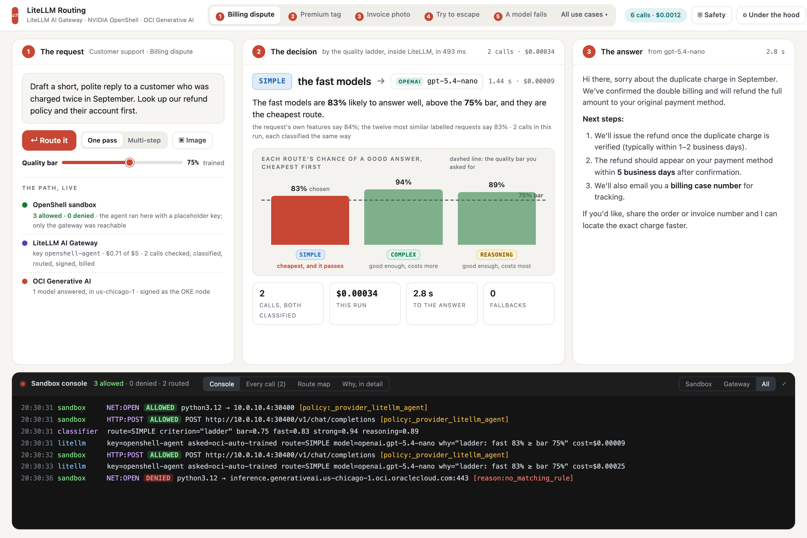

# A better control room: the stage layout (proposal)

*2026-10-12. A proposal for the next version of the control room, written for a
fifteen-minute talk with a six-minute live demo. The mockup is
`docs/ui-proposal/stage.png` (source `stage.html`, rendered by `render.mjs`).
What is marked **done** shipped today; the rest is the proposal.*

## What is still confusing

1. **The story is vertical.** The request, the decision and the answer stack,
   so at 1500×1000 the audience sees two of the three and the details need a
   scroll. On a projector at 1280×720 it sees less. A six-minute demo cannot
   scroll.
2. **The rail competes with the stage.** Sixteen use cases in six groups, each
   with a line of explanation. The talk uses five.
3. **The key visual is small.** The ladder, which carries the whole argument
   ("83% against a 75% bar, and the cheapest"), is a 300 px side panel in 11 px
   type.
4. **The sandbox was invisible.** OpenShell showed as one line under the
   request and a tab at the bottom, and only after a run. **Done:** the
   Sandbox console is dark, prominent and open by default, every connection the
   sandbox opens or is refused appears as it happens with its policy, a Safety
   drawer explains the three layers, and the header names NVIDIA OpenShell, as
   the Deep Agents app does.
5. **Two top-level tabs split attention.** "How the router decides" is depth
   for the presenter, not the story.
6. **The header carries operator status** (gateway role, how calls are signed)
   that the audience does not need.

## The proposal

One screen, nothing to scroll, four areas:

- **Header.** The name and the subtitle; the demo's five beats as a numbered
  strip (the arrow keys move; each beat loads its use case and its mode); "All
  use cases" opens the full list in a drawer; one spend pill; **Safety**
  (done); **Under the hood**, a drawer with Compare routers, The classifier and
  The gateway, which replaces the second tab.
- **Row one, three columns.** **1 The request:** the text, one pass or
  multi-step, the image, the quality bar, Route it; under it *The path, live*:
  three rows that change state during the run (OpenShell: allowed and denied;
  LiteLLM: the key, its spend, calls classified; OCI: the models that
  answered). **2 The decision:** the route and the model as the headline, the
  sentence, then the ladder as a column chart with the quality bar drawn
  across it, cheapest route first, and four run stats. **3 The answer.**
- **Row two.** The Sandbox console, full width, with Every call, Route map and
  Why, in detail as tabs on the same dark header.
- **Multi-step.** Column two shows the planner's line and a row per task
  (route, model, cost); the console groups its lines by task.
- **Stage mode** (key S): type at 1.25×, operator chrome hidden; for the room.

Why it works for the talk: request, decision and answer are visible at once;
the console under them makes the sandbox a constant presence; the ladder
becomes the explanation ("the cheapest route above the line wins"); the five
beats replace reading the rail, and the keyboard moves the demo.

## The name

"LiteLLM routing control room" is long and says "room" twice over the screen.
Options, with the subtitle already in place (`LiteLLM AI Gateway · NVIDIA
OpenShell · OCI Generative AI`):

1. **LiteLLM Routing** (recommended: it names the thing, as "Deep Agents" does)
2. **The Right Model** (the talk's title)
3. **Route Room**

## What it costs

| Piece | Where | Effort |
|---|---|---|
| Sandbox console, Safety drawer, header subtitle, console open by default | `web/src` | done |
| Stage layout: three columns, the ladder as a chart, the beats strip, the two drawers | `web/src/components/Ask.tsx`, a new `Ladder` chart, `App.tsx` | about a day; no backend change, every value on the screen already arrives in the run's events |
| Stage mode and the keyboard | `App.tsx` | about two hours |
| The rename | `App.tsx`, `web/index.html`, `README.md`, `docs/DEMO.md`, the deck | an hour |

## Open

- The name.
- Whether the rail disappears into a drawer or stays, collapsed, on the left.
- Whether the "under the hood" screens stay full screens or become drawers.
